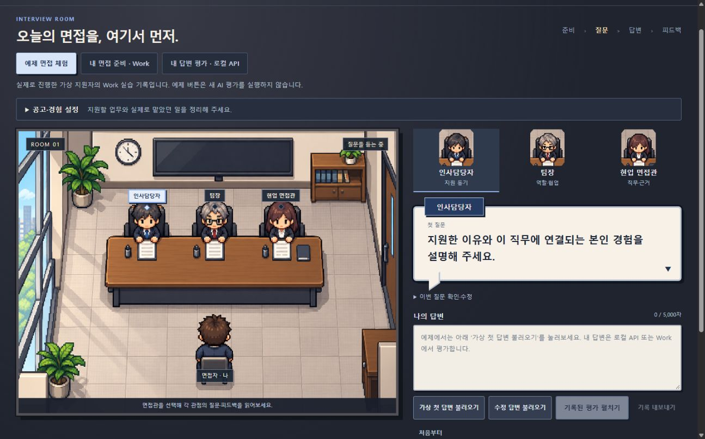

# AI 모의면접실

인사담당자·현업·팀장의 피드백을 나란히 보면서 답변을 고치는 한국어 면접 연습 키트입니다.

**[모의면접실 열기](https://tracert7.github.io/ai-interview-panel/)** · [Work 시작 요청문](docs/work-start.txt) · [실제 3개 에이전트 확인 화면](docs/images/work-agents.jpg)



## 시작하기

설치 없이 위 **모의면접실 열기**를 누르면 픽셀아트 면접실에서 시작합니다. 세 면접관 중 한 명을 선택하고 질문을 읽은 뒤 **가상 첫 답변 불러오기 → 기록된 평가 펼치기**를 눌러보세요. **수정 답변 불러오기 → 기록된 평가 펼치기**로 같은 질문의 수정 전후를 비교할 수 있습니다. 예제는 실제 Work 평가 기록이며 새 답변을 평가하지 않습니다.

면접 중에는 방과 질문 말풍선·답변 입력란을 먼저 보여줍니다. 평가가 끝나면 아래 **면접 피드백 노트**가 열립니다. 방 안의 면접관 이름이나 오른쪽 캐릭터를 선택하면 해당 관점의 꼬리질문을 말풍선에서 읽을 수 있습니다. 캐릭터는 역할을 구분하는 그림이며 표정·시선·음성을 분석하는 기능이 아닙니다.

내 면접에 쓰려면 **내 면접 준비 · Work**를 선택합니다.

1. 공고와 확인된 본인 경험을 입력합니다. 이름·연락처·민감정보·회사 비공개 자료는 넣지 않습니다.
2. **내 내용으로 Work 요청문 복사**를 누릅니다. 복사가 막히면 TXT를 받거나 펼친 요청문을 직접 복사합니다.
3. [ChatGPT](https://chatgpt.com/)의 새 대화에서 **Work**를 선택하고 붙여 넣습니다. 제공 대상 계정에 Work와 서브에이전트 기능이 있어야 합니다.
4. 첫 질문에 답합니다. 활동 목록의 실제 서브에이전트가 3개인지 확인하고, 각 개별 최종 응답을 엽니다. 역할 이름 세 개가 적힌 일반 답변과 구분하세요.
5. 고칠 점 하나를 반영해 같은 질문에 다시 답합니다. 점수가 올라야 한다고 지시하지 않습니다. 다음 질문은 하나씩 진행합니다.

Work는 기존 ChatGPT 사용량을 소모합니다. GitHub 키트가 Work를 무료로 제공하거나 자동 설치하지는 않습니다. 공개 웹 화면은 Work 대화를 자동으로 읽거나 제어하지 않습니다.

## 앱 안에서 새 답변을 바로 평가하려면

**로컬 API 모드**는 별도 역할 지침을 가진 평가 요청 3개를 병렬 실행합니다. 각 요청에는 같은 입력과 자신의 역할만 전달하고 서로의 결과는 보내지 않습니다. Work의 내장 서브에이전트를 호출하는 기능은 아닙니다. 도구를 사용하는 자율 에이전트나 서로 다른 기반 모델 세 개라는 뜻도 아닙니다.

Node.js 22 이상과 본인 OpenAI API 키, 계정에서 사용할 수 있는 Responses API·구조화 출력 지원 모델이 필요합니다. API 요금은 ChatGPT 구독과 별개입니다. **공개 사이트에 API 키를 넣지 마세요.** 키는 로컬 서버 환경변수에만 두며 브라우저로 보내지 않습니다.

1. [Code → Download ZIP](https://github.com/tracert7/ai-interview-panel/archive/refs/heads/main.zip)으로 받고 압축을 풉니다.
2. [Node.js 공식 사이트](https://nodejs.org/)에서 LTS 버전을 설치합니다. 이미 22 이상이면 그대로 사용합니다.
3. 압축을 푼 폴더에서 터미널을 열어 `npm start`를 실행합니다. 설치할 외부 패키지는 없습니다.
4. 표시된 `http://127.0.0.1:4317`을 엽니다. 키 없이도 예제와 Work 요청문을 쓸 수 있습니다.
5. 실제 API 평가를 사용하려면 서버를 종료하고, **본인 PC에서만** 다음 환경변수를 설정한 뒤 다시 시작합니다. 아래 문자열은 실제 값으로 바꿉니다. `.env.example`은 설명 파일이며 서버가 `.env`를 자동 로딩하지 않습니다.

Windows PowerShell:

```powershell
$env:OPENAI_API_KEY = '본인의 API 키'
$env:OPENAI_MODEL = '계정에서 사용 가능한 모델 ID'
npm start
```

macOS / Linux:

```sh
export OPENAI_API_KEY='본인의 API 키'
export OPENAI_MODEL='계정에서 사용 가능한 모델 ID'
npm start
```

6. **로컬 API 평가**에서 연결 상태를 확인합니다. 전송과 비용 동의에 체크하고 평가 버튼을 누릅니다. 공고·경험·질문·답변이 OpenAI로 전송됩니다.

답변 하나당 최대 3회 호출하고 자동 재시도하지 않습니다. 역할당 출력 한도는 1,800토큰이며 입력과 모델에 따라 비용이 달라집니다. 동시 평가는 한 건, 전체 대기 제한은 90초입니다. 중단은 이미 발생한 비용을 취소하지 않습니다. 서버를 공용 네트워크에 노출하거나 포트 포워딩하지 마세요. 공용 서비스용 로그인·과금·다중 사용자 격리는 포함하지 않았습니다.

## 화면에서 할 수 있는 일

- 픽셀 면접실의 세 면접관·지원자 장면과 선택한 면접관의 질문 말풍선
- 질문 → 답변 → 피드백 순서, 평가 전에는 접어 두는 피드백 노트
- 공고·경험·질문·답변을 한 화면에 정리
- 역할별 대기·완료·실패 상태, 5개 항목 점수와 근거·보완점·꼬리질문 표시
- 같은 공고·경험·질문에 답변을 다시 제출해 회차별 비교
- 꼬리질문 하나를 선택해 다음 답변 연습
- 평가 중단, 기록 JSON 내보내기, 입력 지우기

브라우저 저장소·분석 추적·회원가입·자동 업로드는 없습니다. 입력과 결과는 탭 메모리에만 있어 새로고침하면 사라집니다. 내보낸 파일에는 본인이 입력한 경험과 답변이 포함되므로 공개 저장소에 올리지 마세요. `store:false`는 API 응답 저장 옵션이며 서비스의 모든 보존 정책을 없앤다는 뜻이 아닙니다.

## 실제로 확인한 범위

2026-10-18, Chrome의 ChatGPT **Work / GPT-6.1 Sol / Light**에서 가상 지원자의 답변 두 개를 테스트했습니다. 실제 서브에이전트 3개를 생성하고 각 응답 6개를 열어 확인했습니다. Work는 두 번째 평가에서 기존 세 개를 재사용했다고 보고했으며, 새로고침 후 기록도 유지됐습니다.

|역할|첫 답변|수정 답변|
|---|---:|---:|
|인사담당자|12 / 20점|19 / 20점|
|현업|11 / 20점|18 / 20점|
|팀장|11 / 20점|19 / 20점|

예제 JSON은 이 실제 응답을 웹 화면에 맞게 구조화한 기록입니다. 점수·근거·보완점·꼬리질문은 원문을 유지했습니다. 별도의 답변 인용값이 없는 예제에는 인용을 새로 만들지 않았습니다. 합계는 코드로 재계산합니다.

로컬 API 연결은 요청 구성·분리·출력 검증·오류·부분 실패를 **가짜 전송 계층 테스트**로 확인합니다. **유료 API 실호출·특정 모델의 실점수·음성 스트리밍·채용 결과는 검증하지 않았습니다.** 새 API 결과가 Work 예제 점수와 같다는 보장도 없습니다. 서로 다른 관점의 연습 피드백이지 통계적으로 독립적인 사람 면접관의 판정이 아닙니다.

## 평가 기준

질문 적합성 / 본인 행동 / 구체적인 근거 / 전달 구조 / 사실 일관성, 각 0~4점입니다. 총점은 20점이며 합격률·능력 향상률·지원자 순위로 바꾸지 않습니다. 자료에 없는 경험은 ‘거짓’ 대신 ‘확인 필요’로 남깁니다. 연습을 돕는 기준이지 표준화된 채용 검사 도구는 아닙니다.

## 개발·검증

```sh
npm test
```

외부 패키지 없이 Node 표준 기능으로 실행합니다. `server.mjs`는 `127.0.0.1`에만 바인딩하고, Host·Origin·요청 헤더를 확인합니다. 응답의 점수 범위와 인용 원문을 검증하고 화면에는 `textContent`로 표시합니다. 답변·키를 로그나 파일에 쓰지 않습니다. 역할별 API 호출의 실제 사용량이 반환되면 내보내기 JSON에 보관합니다. 금액은 추정하지 않습니다.

## 근거와 이용 안내

- [Work의 실제 서브에이전트](https://learn.chatgpt.com/docs/agent-configuration/subagents)
- [Chat과 Work](https://learn.chatgpt.com/docs/use-chatgpt)
- [Responses API](https://developers.openai.com/api/reference/resources/responses/methods/create)
- [구조화 출력](https://developers.openai.com/api/docs/guides/structured-outputs)
- [API 데이터 안내](https://developers.openai.com/api/docs/guides/your-data)

이 저장소는 공개 열람·다운로드용입니다. 별도 오픈소스 라이선스는 아직 부여하지 않았습니다. OpenAI 공식 서비스나 채용 평가 서비스가 아닙니다.

면접실 배경은 사용자가 제공한 참고 이미지의 픽셀아트 분위기를 바탕으로 내장 이미지 생성 도구에서 제작했습니다. [제작 요청문](design/interview-room-art-prompt.md)을 함께 남겼으며, 원본 참고 이미지·계정 정보는 저장소에 포함하지 않았습니다. 질문·버튼·이름표는 이미지에 그려 넣은 텍스트가 아니라 실제 HTML입니다.
